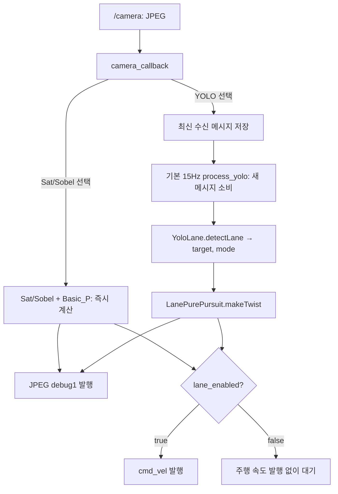

# driving

팀원들이 개발한 차선 검출과 조향 알고리즘을 하나의 ROS 2 노드에서 연결하는 Python 패키지다. 공통 노드는 영상·선택 토픽·파라미터·발행을 관리하고, 검출과 조향은 각각의 파일에서 계산한다. 미션은 외부 패키지를 사용하고 이 패키지는 주행 허용 신호를 받는다.

**목표 환경은 ROS 2 Galactic / Python 3.8이다.** 현재 개발 VM의 Humble/Python 3.10 검증과 Galactic·실차 검증은 구분한다.

- 새 알고리즘 이식: [CONTRIBUTING.md](CONTRIBUTING.md)
- 에이전트 작업 원칙: [AGENTS.md](AGENTS.md)
- YOLO 원본과 모델 출처: [models/README.md](models/README.md)

## 구조와 호출 순서

```text
driving/
├── driving/
│   ├── driving.py                # ROS 통신, 파라미터, 선택 분기, 15Hz 타이머
│   ├── driving_debug.py          # 카메라/디버그 영상 6개 토픽의 imshow 뷰어
│   ├── detection/
│   │   ├── basic_sat.py          # 밝기 변환 → 한쪽 ROI 중심
│   │   ├── basic_sobel.py        # Sobel 경계 → 한쪽 ROI 중심
│   │   ├── yolo_lane.py          # JPEG → BEV → YOLO → 목표점과 mode
│   │   └── lane_estimator.py     # 원본 BEV/차선 곡선/목표점 계산
│   └── steering/
│       ├── basic_p.py            # ROI 중심 → Twist
│       └── pure_pursuit.py       # 미터 목표점 → 원본 PurePursuit → Twist
├── models/lane_yolo26n_seg.pt
├── requirements-yolo.txt
├── package.xml
└── setup.py
```

`__init__.py`와 문서 등은 생략했다. 알고리즘 연결은 노드의 명시적 분기로 작성한다. 계산 객체를 재사용하며, 기본 YOLO 모델은 대기 중에도 첫 영상 처리 때 한 번 로드한다. 첫 YOLO 처리 전에 basic 조합으로 선택을 바꾸면 Ultralytics를 import하거나 모델을 로드하지 않는다.



주행 노드는 디버그 영상을 생성해 `/debug1`에 JPEG로 발행한다. 로컬 창을 띄우지 않으므로 화면 환경 없이 실행할 수 있다. 화면 표시는 별도 `driving_debug` 노드가 담당한다.

YOLO 타이머는 저장된 메시지를 꺼내고 저장 자리를 비운다. 새 입력이 없으면 같은 영상을 다시 계산하거나 속도를 반복 발행하지 않는다. Sat/Sobel은 영상 콜백에서 기존대로 처리한다.

**15Hz는 목표 처리 주기다.** 단일 executor에서 동기 추론하므로 전체 처리 시간이 약 66.7ms를 넘으면 실제 15fps를 보장하지 않는다. 추론 중 영상·주행 상태·선택·파라미터 서비스 콜백도 지연될 수 있다. `/lane_state=false`도 진행 중인 추론을 중단시키지는 않으며, 해당 콜백이 실행될 때 정지한다. 저장하는 최신 영상은 구독 콜백이 실제 수신한 것 중 최신이며 DDS 큐 전체의 지연까지 제거하는 기능은 없다. 별도 worker는 없다.

## 알고리즘별 입력과 결과

기본 선택은 `yolo_lane`이다. 검출기마다 조향기가 고정되어 있으며, 노드 시작 시 주행은 비활성이다. 대기 중에도 `/camera` 영상으로 검출·조향 계산과 디버그 발행을 계속한다. `/lane_state=true`로 주행을 허용한 뒤 새로 수신한 영상부터 계산된 속도를 발행한다. 검출기 선택만으로 주행이 시작되지는 않는다.

| 검출 | 조향 | 전달하는 결과 |
| --- | --- | --- |
| `basic_sat` | `basic_p` | 한쪽 ROI 내부 픽셀 x좌표와 좌우 모드 |
| `basic_sobel` | `basic_p` | 같은 좌표계의 중심과 좌우 모드 |
| `yolo_lane` | `pure_pursuit` | `(target, mode)`: 미터 단위 목표점과 검출 상태 |

`/driving/detection`으로 검출기 하나를 선택하면 위 표의 조향기를 직접 호출한다. 별도 `/driving/steering` 토픽은 사용하지 않는다. 검출 선택 이름이 바뀌면 먼저 0 `Twist`를 발행하고 YOLO 대기 영상, 차선 추적, 조향 평활화 상태를 비운다. 돌아왔을 때 모델은 재사용하며 새 영상을 기다린다. 잘못된 이름·빈 이름은 무시하고, 같은 이름 재전송은 초기화하지 않는다.

### basic

두 검출기는 640×480 BGR 영상이 필요하다. 640×120으로 원근변환한 다음 한쪽 320×120 ROI를 처리한다.

| 항목 | 동작 |
| --- | --- |
| 왼쪽 | `basic.lane_mode=true`, ROI `x=0:320`, 조향 목표 60 |
| 오른쪽 | `basic.lane_mode=false`, ROI `x=320:640`, 조향 목표 260 |
| 정상 반환 | 해당 ROI 내부의 x좌표 0~319 |
| 차선 미검출 | 왼쪽 0 / 오른쪽 320으로 조향 |
| 디버그 | 이진 ROI를 BGR로 바꾸고 `(center, 60)`에 빨간 점 |

Sat은 회색 밝기에 `clip(29.12 * 밝기 + beta, 0, 255)`를 적용하며 HSV 채도 계산은 아니다. Sobel은 x방향 경계와 형태학 처리, 작은 연결요소 제거를 사용한다. 여러 윤곽의 중심이 평균에 포함될 수 있다. 미검출 대체값에도 점이 찍히므로 점 표시만으로 검출 성공을 판단하지 않는다. 오른쪽 대체값 320의 점은 일부가 영상 밖에 놓인다.

검출과 `Basic_P.makeTwist(center, lane_mode)`에 같은 모드를 전달한다. Basic_P는 모드를 객체에 저장하지 않으며 인자 생략 시 왼쪽 기준인 `True`를 사용한다. 기존 basic 계산과 향후 사용 예정인 ROI·색상·교차로 설정은 유지했다. 사용하지 않는 창 이름 설정은 제거했다.

### YOLO + Pure Pursuit

입력은 원본과 같은 `/camera`의 보정된 영상이다. JPEG 디코딩 → 640×480 BEV → YOLO segmentation → 색별 차선 곡선 → 중앙 경로 → 목표점 순서다. 다른 크기는 원본 `to_bev`처럼 640×480으로 resize하지만, 카메라 기하까지 자동 보정하는 것은 아니다. basic의 640×120 변환은 사용하지 않는다.

- 모델 클래스: `0=white`, `1=yellow`. 왼쪽 노란 차선과 오른쪽 흰 차선을 가정한다.
- `target`: 차축 기준 `(전방 x, 좌측 y)` 좌표이며 단위는 m. 미검출은 `None`.
- `mode`: `both`, `yellow_only`, `white_only`, `lost`. 외부 실행 상태 토픽과 별개인 내부 검출 결과다.
- 양쪽 차선은 중앙 경로를, 한쪽 차선은 원본 법선 offset 경로를 계산한다. 비정상 차선 폭에서 이전 목표점과 가까운 차선을 선택하는 원본 규칙도 유지한다.
- 목표점은 `LanePath.target()`으로 구해 `PurePursuit.compute_to()`에 전달한다. 범용 `compute(path)`는 목표점 선택 방식이 달라 사용하지 않는다.
- 정상 차선 추종의 최대 속도 기본값은 0.40m/s, 한쪽 검출은 계산 속도의 0.8배다.
- `/intersection_state`가 `true`이면 최대 속도 기준을 `pure_pursuit.v_max_intersection`(기본 0.30m/s)으로 바꾸고 곡률에 원본 배율 0.7을 적용한다. 이후 곡률 감속·한쪽 차선 배율·각속도 제한·평활화 순서는 원본과 같다. 최종 속도를 항상 0.30으로 고정하거나 최종 각속도에 단순히 0.7을 곱하는 방식이 아니다.
- **정상 영상의 차선 미검출은 원본처럼 0.05m/s 직진, 각속도 0이다.** 정지 정책과 다르다.
- 디버그는 BEV 위에 마스크, 차선 곡선, 중앙 경로, 목표점, ROI와 속도를 표시한다. 원본 `draw()`를 사용하며 JPEG header는 입력 header를 보존한다.

`/lane_state`로 주행을 허용하고 `yolo_lane`을 선택했을 때 YOLO를 처리한다. `/intersection_state`는 YOLO 조향의 교차로 정책만 바꾼다. 기본 상태는 `false`이고 마지막으로 수신한 값을 다음 상태 메시지까지 유지한다. 알고리즘을 바꿔도 이 값은 유지하며 Sat/Sobel + Basic_P 계산에는 적용하지 않는다. 교차로 상태 변경 자체는 차선 추적·조향 평활화를 초기화하지 않고 다음 YOLO 처리에 반영된다. 미검출은 교차로에서도 `v_lost` 직진 정책을 따른다. 기본 BEV 변환점, 카메라 높이, 차축 위치와 차선 폭의 실물 적합성은 대상 카메라에서 확인해야 한다.

## 빌드와 실행

ROS 의존성은 [package.xml](package.xml), YOLO Python 의존성은 [requirements-yolo.txt](requirements-yolo.txt)에 있다. 기본 YOLO 주행에는 PyTorch/Ultralytics가 설치된 실행 환경이 필요하다. 모델은 빌드 시 `share/driving/models`에 설치된다.

다음은 Galactic 기준 명령이다. 현재 Humble 개발 VM에서는 ROS setup 경로를 `/opt/ros/humble/setup.bash`로 바꾼다.

```bash
source /opt/ros/galactic/setup.bash
DRIVING_WS="$HOME/turtlebot3_ws"
cd "$DRIVING_WS"
rosdep install --from-paths src/driving --ignore-src -r -y
PYTHONNOUSERSITE=1 /usr/bin/colcon build --symlink-install --packages-select driving
source install/setup.bash
```

빌드는 기본 ROS 환경에서 시스템 colcon을 사용한다. 위 `PYTHONNOUSERSITE=1`은 사용자 영역 setuptools가 시스템 빌드 도구와 섞이는 기존 충돌을 피하기 위한 실행 설정이며 패키지를 삭제하지 않는다.

YOLO는 ROS와 같은 시스템 Python 기반 venv에 PyTorch/torchvision/Ultralytics를 준비한다. 이미 환경이 있으면 다시 만들지 않는다. 현재 개발 환경 경로는 `~/turtlebot3_ws/.venv`이며 venv에 `COLCON_IGNORE`를 둔다. 기본 환경에서 빌드한 console script의 Python은 venv 활성화만으로 바뀌지 않으므로, YOLO 실행은 인터프리터를 명시한다.

```bash
source /opt/ros/galactic/setup.bash
DRIVING_WS="$HOME/turtlebot3_ws"
source "$DRIVING_WS/install/setup.bash"
"$DRIVING_WS/.venv/bin/python" -m driving.driving --ros-args \
  -r cmd_vel:=cmd_vel_preview -p yolo_lane.device:=cpu
```

위 프로세스는 YOLO + Pure Pursuit를 선택한 상태로 주행을 기다린다. `/camera` 입력이 있으면 대기 중에도 모델을 로드해 검출·조향 계산을 수행하고 `/debug1`에 JPEG를 발행한다(`yolo_lane.publish_debug=true`일 때). 아래 주행 시작 명령 이후 새로 수신한 영상부터 속도도 발행한다. 카메라 발행기나 bag 변환기는 별도로 실행해야 하며, 이 패키지는 입력 영상을 만들지 않는다. `/camera_raw_16_9`만 재생하면 `/camera`를 사용하는 계산은 시작되지 않는다. basic만 사용할 때는 아래의 검출 선택 명령 하나를 적용한다. YOLO 의존성이 없는 환경에서는 카메라 입력을 시작하기 전에 basic 조합을 선택한다.

Jetson Orin Nano / JetPack 5에서는 해당 JetPack·Python에 맞는 NVIDIA PyTorch/torchvision을 별도로 준비한다. VM의 venv·wheel을 그대로 복사하지 않으며, 의존성 설치가 해당 torch를 일반 CPU 패키지로 교체하지 않게 관리한다. 실제 CUDA 추론은 대상 장치에서 검증해야 한다.

`cmd_vel_preview`는 검증용 출력이다. 실제 로봇에 연결할 때만 remap을 제거한다. 통신할 터미널끼리 ROS setup, workspace setup, `ROS_DOMAIN_ID` 등을 맞춘다.

## 주행 시작과 정지

노드를 실행한 뒤 ROS 환경을 읽은 다른 터미널에서 필요한 명령만 실행한다.

```bash
# 주행 시작 / 재개
ros2 topic pub --once /lane_state std_msgs/msg/Bool "{data: true}"
# 주행 정지
ros2 topic pub --once /lane_state std_msgs/msg/Bool "{data: false}"
```

`false`를 받을 때마다 0 `Twist`를 한 번 발행하고 YOLO 미처리 영상·차선 추적·조향 평활화를 초기화한다. 모델과 검출기 선택, 교차로 상태는 유지한다. 이후 대기 중에도 새 영상의 검출·조향 계산과 디버그 발행은 계속되므로 추적·평활화 상태는 다시 갱신된다. 영상 처리 경로에서는 정상 속도와 오류 시의 0 속도 모두 발행하지 않는다. 명시적인 정지 신호, 검출 선택 변경, 정상 종료 시의 0 속도 발행은 유지한다.

`false → true`로 전환할 때는 미처리 YOLO 영상만 버리고, 이후 카메라 콜백이 받은 영상부터 주행 속도를 발행한다. 대기 중 계산한 추적·평활화는 유지한다. `true` 수신 자체는 속도를 발행하지 않으며, 이미 주행 중인 상태에서 `true`를 다시 보내면 미처리 영상도 그대로 유지한다. 이는 콜백 수신 순서 기준이며 촬영 시각을 검사하거나 DDS 수신 큐를 비우는 기능은 아니다. 정지 중에 검출기를 바꿔도 정지 상태가 유지된다. 노드를 재시작하면 다시 `false`에서 주행을 기다린다.

수동 주행 시험에는 위 명령을 사용한다. 신호등을 통한 출발은 아래 미션 시작 명령을 사용한다.

## 외부 미션 패키지 연결

미션 노드는 [참조 저장소](https://github.com/hakeee0331/turtlebot3_autorace_2026_/tree/ab08e4779511d04c3db31c3163b6b21e5a3ae767/mission)의 별도 패키지를 사용한다. `driving`에는 미션 구현이나 실행 엔트리를 두지 않는다. 차선 주행과 `/lane_state` 수신을 담당하고, 미션의 판정·시작·완료는 외부 패키지가 담당한다.

원본 신호등 패키지를 별도로 설치·빌드한 경우 다음처럼 실행한다. 카메라와 `driving`을 먼저 실행하고 각각의 터미널에서 ROS와 workspace 환경을 읽는다.

```bash
# 별도 터미널: 외부 신호등 패키지 실행
ros2 run traffic_light detection
```

```bash
# 별도 터미널: 주행을 정지한 뒤 외부 미션 시작
ros2 topic pub --once /lane_state std_msgs/msg/Bool "{data: false}"
ros2 topic pub --once /traffic_light_state std_msgs/msg/Bool "{data: true}"
```

원본 신호등은 `/camera2`의 `CompressedImage`를 처리하고 초록 조건 충족 시 `/lane_state=true`를 발행한다. 시작/취소 신호 자체는 `/lane_state=false`를 발행하지 않으므로 미션을 시작할 때 위처럼 정지 상태를 먼저 설정한다. `/camera2`는 이 작업공간의 `camera_ros`에서 `publisher2`가 제공하며 `camera.launch.py`에 포함되어 있다.

현재 `driving`은 `/traffic_light_state`나 `/lane_mode`를 구독하지 않는다. 외부 미션이 발행하는 `/lane_state`로 주행을 허용하고, `/intersection_state`는 YOLO 속도·곡률 정책에만 적용한다. `/lane_mode`를 발행한다고 basic 파라미터나 YOLO 추종 방향이 바뀌지는 않는다.

참조 신호등은 자체 `imshow`를 사용하며 이 패키지의 신호등 JPEG 토픽은 없다. 원본의 상태 자기 재발행·GUI·종료 처리는 외부 패키지에 남아 있으며, 여기서 수정하거나 실제 실행 검증한 것은 아니다. `driving_debug`는 입력 `/camera2`를 표시할 수 있다. 외부 미션 패키지의 빌드·수정·전체 연동 검증은 별도 작업으로 다룬다.

## 영상 디버그 노드

GUI를 사용할 수 있는 로컬 데스크톱 터미널에서 별도로 실행한다. 빌드 후 ROS와 workspace setup을 읽는다.

```bash
ros2 run driving driving_debug
```

뷰어는 다음 여섯 토픽을 모두 `sensor_msgs/msg/CompressedImage`와 `qos_profile_sensor_data`로 구독한다. 토픽 이름은 상대 이름이므로 namespace와 ROS remap을 사용할 수 있다.

| 창 제목 / 기본 토픽 | 영상 |
| --- | --- |
| `camera` / `/camera` | 보정된 입력 영상 |
| `camera_raw` / `/camera_raw` | 보정 전 중앙 crop 영상 |
| `camera_raw_16_9` / `/camera_raw_16_9` | 원본 wide 영상 |
| `camera2` / `/camera2` | 신호등 미션 입력 영상 |
| `debug1` / `/debug1` | 선택한 검출기의 디버그 영상 |
| `debug2` / `/debug2` | 추가 디버그 영상; 현재 주행 노드는 발행하지 않음 |

각 토픽에서 정상 영상을 처음 받으면 크기 조절 가능한 창을 만들고, 이후 수신 영상으로 갱신한다. 발행되지 않는 토픽에는 창이 생기지 않는다. 빈 메시지·손상 영상은 경고 후 건너뛰며 마지막 정상 화면을 유지한다. 입력 중단 표시나 영상 간 시간 동기화는 구현하지 않았다.

영상 창에 포커스를 둔 상태에서 `q` 또는 `Esc`, 실행 터미널에서 `Ctrl+C`로 뷰어를 종료한다. 종료 시 뷰어의 창을 정리한다. 창의 닫기 버튼만 누르면 다음 수신 때 다시 열릴 수 있으므로 위 종료 방법을 사용한다. 뷰어는 주행 명령이나 알고리즘 선택을 발행하지 않으며, 뷰어를 종료해도 별도 주행 노드는 계속 실행된다.

OpenCV HighGUI를 지원하는 설치와 유효한 디스플레이 세션이 필요하다. 화면 환경 변수가 없는 터미널에서는 안내와 함께 종료한다. 뷰어에는 PyTorch나 Ultralytics가 필요 없으며, 주행 노드·외부 미션 노드와 카메라 발행기·bag 재생은 별도로 실행한다. 추가 영상 토픽은 `driving/driving_debug.py`의 `IMAGE_TOPICS`에 명시적으로 추가한다. 현재 목록 밖 토픽의 자동 탐색이나 비압축 `Image` 변환은 하지 않는다.

다른 이름으로 발행되는 영상을 기존 창에 연결하려면 remap한다. 창 제목은 목록의 이름을 유지한다.

```bash
ros2 run driving driving_debug --ros-args -r debug1:=/another_debug/compressed
```

## 토픽과 선택

소스는 상대 이름을 사용한다. 아래는 namespace/remap이 없을 때의 이름이다. 아래 표는 `driving` 노드의 토픽이며 뷰어의 추가 입력은 위 표에 있다.

| 이름 | 방향 / 메시지 | 역할 |
| --- | --- | --- |
| `/camera` | 구독 / `sensor_msgs/msg/CompressedImage` | 모든 현재 검출기의 입력 |
| `/camera_raw`, `/camera_raw_16_9` | 구독 / `sensor_msgs/msg/CompressedImage` | 마지막 메시지 저장만 수행 |
| `/driving/detection` | 구독 / `std_msgs/msg/String` | `basic_sat`, `basic_sobel`, `yolo_lane` |
| `/lane_state` | 구독 / `std_msgs/msg/Bool` | 외부 미션 또는 수동 주행 허용: 초기 `false`, `true` 재개, `false` 정지 |
| `/intersection_state` | 구독 / `std_msgs/msg/Bool` | YOLO 교차로 모드: `true` 진입, `false` 해제 |
| `/cmd_vel` | 발행 / `geometry_msgs/msg/Twist` | 선속도와 각속도 |
| `/debug1` | 발행 / `sensor_msgs/msg/CompressedImage` | 선택한 알고리즘의 JPEG |
| `/debug2` | 발행자 생성 / `sensor_msgs/msg/CompressedImage` | 현재 발행 없음 |

영상 구독은 `qos_profile_sensor_data`, 선택·주행·교차로 상태 구독과 발행은 depth 10 기본 QoS다. 이름에 raw가 있어도 현재 메시지 타입은 `CompressedImage`다.

```bash
# YOLO + Pure Pursuit 선택. 시작 시에는 이 명령이 필요 없다.
ros2 topic pub --once /driving/detection std_msgs/msg/String "{data: yolo_lane}"
# YOLO 교차로 모드 진입 / 해제 (각각 필요한 시점에 실행)
ros2 topic pub --once /intersection_state std_msgs/msg/Bool "{data: true}"
ros2 topic pub --once /intersection_state std_msgs/msg/Bool "{data: false}"
# Sat + Basic_P 선택
ros2 topic pub --once /driving/detection std_msgs/msg/String "{data: basic_sat}"
# Sobel + Basic_P 선택
ros2 topic pub --once /driving/detection std_msgs/msg/String "{data: basic_sobel}"
```

## 파라미터

선언·조회는 모두 `DrivingNode`가 담당한다. 알고리즘은 노드가 전달한 값을 사용하며 ROS Node를 만들거나 파라미터를 직접 조회하지 않는다. 실수는 `0.5`, 정수는 `640`처럼 타입에 맞게 설정한다.

| 이름 | 기본값 | 적용 시점 / 의미 |
| --- | --- | --- |
| `basic_sat.beta` | `-5080.1` | Sat 프레임마다 / 밝기 변환의 beta, alpha=29.12 고정 |
| `basic.lane_mode` | `true` | basic 프레임마다 / 검출과 조향의 좌우 모드 |
| `yolo_lane.model_path` | 설치된 모델 경로 | 시작 시 / 읽기 전용, 모델은 첫 YOLO 처리 때 로드 |
| `yolo_lane.device` | `''` | 시작 시 / 읽기 전용, 자동 선택 또는 `cpu`, `0` |
| `yolo_lane.process_hz` | `15.0` | 시작 시 / 읽기 전용, 유한한 양수 |
| `yolo_lane.conf` | `0.4` | YOLO 프레임마다 / 신뢰도 기준 0~1 |
| `yolo_lane.imgsz` | `640` | YOLO 프레임마다 / 추론 입력 크기, 양의 정수 |
| `yolo_lane.publish_debug` | `true` | YOLO 프레임마다 / JPEG 발행 여부 |
| `yolo_lane.camera_height` | `0.129` | YOLO 프레임마다 / 카메라 높이 m, 양수 |
| `yolo_lane.roi_top_row` | `220` | YOLO 프레임마다 / BEV ROI 시작 행, 0~479 |
| `yolo_lane.roi_half_width` | `250` | YOLO 프레임마다 / 로봇 기준 ROI 반폭 px, 양수 |
| `yolo_lane.lookahead_row` | `400` | YOLO 프레임마다 / 목표점 행, 0~479 |
| `yolo_lane.single_offset` | `0.6` | YOLO 프레임마다 / 단일 차선으로부터 차선 폭의 몇 배 떨어질지 |
| `yolo_lane.lane_width` | `355.0` | YOLO 프레임마다 / BEV 차선 폭 px, 양수 |
| `pure_pursuit.v_max` | `0.40` | YOLO 프레임마다 / 최대 속도 m/s |
| `pure_pursuit.v_max_intersection` | `0.30` | YOLO 프레임마다 / 교차로 모드의 최대 속도 기준 m/s, 유한한 0 이상 값 |
| `pure_pursuit.v_lost` | `0.05` | YOLO 프레임마다 / 미검출 직진 속도 m/s |
| `pure_pursuit.k_lat` | `1.7` | YOLO 프레임마다 / 곡률 이득 |
| `pure_pursuit.max_ang` | `3.0` | YOLO 프레임마다 / 평활화 전 각속도 제한 rad/s |
| `pure_pursuit.k_v` | `0.6` | YOLO 프레임마다 / 곡률에 따른 감속 |
| `pure_pursuit.ang_smooth` | `0.6` | YOLO 프레임마다 / 새 각속도 비중 0~1 |
| `pure_pursuit.v_single` | `0.8` | YOLO 프레임마다 / 단일 차선 속도 배율 0~1 |

```bash
ros2 param set /driving yolo_lane.conf 0.5
ros2 param set /driving pure_pursuit.v_max 0.12
ros2 param set /driving pure_pursuit.v_max_intersection 0.10
ros2 param set /driving basic.lane_mode false
```

기하 파라미터를 바꾸면 다음 YOLO 프레임에서 `LanePath`를 다시 생성해 차선 추적을 초기화한다. 조향 계산은 프레임마다 값을 받아 기존 평활화 상태를 이어간다. 주행 정지·선택 전환·미검출·처리 오류에서는 조향 상태도 초기화한다.

교차로 곡률 배율 `ang_scale_intersection = 0.7`은 원본처럼 내부 설정이며 `LanePurePursuit`에 둔다. ROS 파라미터는 최대 속도 `pure_pursuit.v_max_intersection`만 복원했다. 이 값은 교차로에서 일반 `v_max`를 대체하므로 `v_max`를 낮춰 시험할 때 교차로 속도도 별도로 조절한다.

시작 전용 파라미터는 실행 중 변경을 거부한다. 재시작 시 `--ros-args -p yolo_lane.process_hz:=10.0`처럼 지정한다. YOLO/PurePursuit의 나머지 숫자 범위 검사는 처리 시점에 수행하므로 `ros2 param set` 성공이 계산 가능한 값을 보장하지는 않는다. 잘못된 값은 처리 오류로 정지하고 로그를 남긴다. 변경값은 재시작 시 유지되지 않는다.

Basic_P의 `normal_angular_divisor` 등은 기존 소스 상수다. 이번 이식에서 ROS 파라미터로 바꾸지 않았다.

## 확인한 결과와 남은 범위

2026-11-04 Ubuntu ARM64 VM / ROS 2 Humble / Python 3.10에서 다음을 확인했다.

- 패키지 단독 colcon 빌드, 모델 share 설치, Python 3.8 문법 검사.
- 원본 BEV/LanePath/PurePursuit 계산 정의 8개의 AST 동일성. 독립 12사례와 연속 12사례에서 원본 일반 차선 계산과 속도·평활화 결과 일치(허용 오차 1e-12), 디버그 픽셀 일치.
- 교차로 복원 후 합성 마스크 32사례에서 원본 일반·교차로 속도/조향 계산과 일치(허용 오차 1e-12), 24사례의 디버그 픽셀 일치. 실제 DDS의 Bool 상태 전환·파라미터 서비스 변경·연속 7사례 계산·미검출·한쪽 차선·basic 복귀·잘못된 속도 설정 시 정지를 확인했다. 이 검사는 모델 추론을 합성 마스크로 대체했으며 Galactic·실차 검증은 아니다.
- 실제 DDS에서 선택 전환·재선택 초기화·모델 재사용·파라미터 반영·JPEG/header·입력 및 추론 오류·기존 basic 좌우 미검출 동작 확인. 추론을 빠른 대체 함수로 바꾼 타이머 검사는 약 15Hz였다.
- 검출별 조향기를 고정한 뒤 `/driving/detection` 하나로 YOLO↔Sat↔Sobel 전환을 확인했다. 전환 시 정지/대기 영상 폐기/추적 초기화, 모델 재사용, 잘못된 이름·동일 이름 처리와 교차로 상태 유지도 확인했다. 실제 DDS를 사용하고 모델 추론은 합성 마스크로 대체했으며 검출·조향 계산 파일은 변경하지 않았다.
- `/lane_state` 최초 추가 시에는 대기 중 계산도 중지하는 정책으로 실제 DDS에서 세 검출기의 시작·정지·재개, 정지 중 선택 변경, 반복 정지의 0 Twist, 반복 시작의 추적 유지, 대기 영상 폐기와 새 영상 처리, 모델 재사용·교차로 상태 유지·손상 입력·JPEG를 확인했다. YOLO 모델 생성/추론만 합성 대체했다. 현재는 대기 중 계산을 유지하는 정책으로 변경했다.
- 대기 중 계산 유지 변경 후 실제 DDS에서 Sat/Sobel/YOLO의 대기 중 JPEG 발행과 정상·손상 영상의 속도 발행 차단, 주행 중 오류의 0 속도, 정지 후 디버그 갱신을 확인했다. False→True 시 미처리 영상 폐기와 추적 유지, 새 영상으로 주행 재개, 반복 True 시 미처리 영상 보존, 모델 재사용·로딩/추론 오류 처리·디버그 파라미터도 확인했다. YOLO 모델 생성/추론은 합성 대체했고 기존 검출·조향 파일은 변경하지 않았다.
- GUI 제거 후 화면 환경 변수 없이 Sat/Sobel의 320×120 JPEG와 YOLO의 640×480 JPEG 수신을 확인했다. 이 확인에서 YOLO 표시본은 준비한 검출 상태로 생성했으며 모델 추론은 재실행하지 않았다. YOLO 입력 header와 기존 발행 활성화 설정도 유지된다.
- `driving_debug` 최초 추가 시 실제 DDS에서 당시 다섯 영상 토픽의 수신·JPEG 디코딩·개별 갱신·손상 입력 처리·namespace/remap을 확인했다. HighGUI 호출을 대체해 창 생성과 q/Esc 종료, Ctrl+C 및 정상 종료의 창 정리를 검사했다. 현재 실행 환경에는 디스플레이 연결이 없어 실제 창 표시는 미검증이다. 노드 import에 PyTorch/Ultralytics가 필요하지 않음도 확인했다.
- `normal` bag의 원본 영상을 camera_ros 방식으로 보정한 5개 표본에서 실제 CPU YOLO 추론과 ROS 발행 확인. 첫 표본은 원본 추론 함수와 마스크가 같았고, 5개 모두 같은 검출 결과에 대한 원본 속도 명령과 일치했다.
- `/lane_state` 추가 전에는 기본 선택을 YOLO/Pure Pursuit로 변경한 뒤 선택 메시지 없이 첫 영상부터 처리됨을 확인했다. 현재는 주행 속도 발행에 허용 신호가 필요하며 영상 처리는 대기 중에도 수행한다. 위 bag 표본 5장에 대해 원본과 현재 모델을 각각 로드해 추론하고 일반·교차로 상태를 전환했다. 모든 표본의 BEV·마스크·클래스·신뢰도가 동일했고, 목표점·속도·조향·디버그 결과도 일치했다. 동일 설정·상태의 계산 비교이며 입력 오류 처리나 실시간 파라미터 적용 시점까지 원본과 동일하다는 의미는 아니다.
- 최초 측정에서 모델 초기화 포함 약 0.63초, 이후 전체 프레임 처리 약 89~96ms였다. 이 VM에서 실제 15fps 달성 결과가 아니며 처리 여력은 대략 10~11fps 수준이다. 실행 부하에 따라 달라진다.

실제 Galactic/Python 3.8 런타임, Jetson GPU, 실차, 전체 bag 정확도·완주는 검증하지 않았다. 원본과 계산이 같다는 사실이 현재 카메라에 맞는 보정이나 주행 성능을 보장하지 않는다.

- **입력 중단:** 새 메시지가 없으면 처리를 건너뛴다. 입력 timeout 정지는 아직 없으므로 마지막 속도 명령에 대한 구동부 동작을 별도로 확인해야 한다.
- **종료:** ROS가 살아 있는 정상 종료 경로에서 0 Twist 발행을 시도한다. 강제 종료·통신 종료 상황의 전달 보장은 없다.
- **입력 오류와 미검출:** YOLO 로딩/추론/처리 오류는 상태를 초기화하며 주행 허용 중에만 0 속도를 발행한다. Sat/Sobel 입력 오류도 주행 허용 중에만 0 속도를 발행한다. 정상 미검출은 위 알고리즘별 정책으로 계산하며 대기 중에는 속도를 발행하지 않는다. Basic_P의 `None` 대체 처리는 주석 상태다.
- **디버그:** YOLO는 입력 header를 보존하지만 basic은 현재 시각/빈 frame_id를 사용한다. basic 디버그는 기존처럼 검출·조향 예외 처리 밖에 있다. JPEG 인코딩은 동기 처리다. 주행 노드에는 창 표시와 키 입력 처리가 없으며 별도 `driving_debug` 노드가 담당한다. 뷰어의 입력이 끊기면 마지막 정상 화면이 남는다.
- **raw 입력:** 저장만 하며 세 토픽의 시간 동기화는 없다. 새 알고리즘에서 처리 시작 콜백과 입력 준비 조건을 연결해야 한다.
- **기존 주석:** basic 일부 주석은 미검출 None, Sobel 해상도 오류 문구는 basic_sat을 언급한다. 실제 동작과 이 문서를 기준으로 읽는다.
